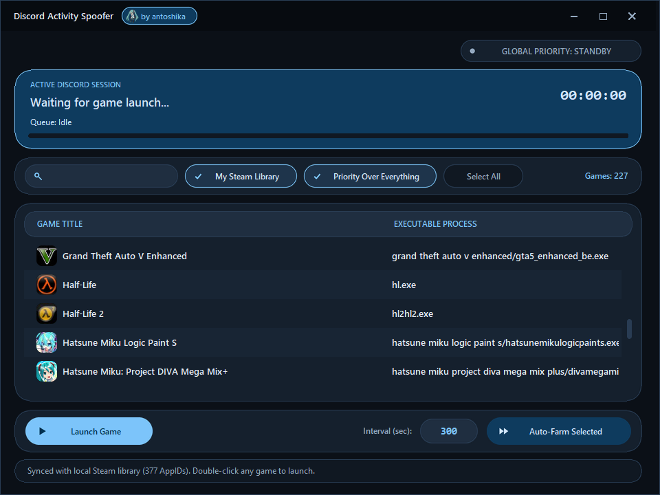

#  Discord Activity Spoofer

Desktop utility for improving progress icons in Discord. <i>(Game Time, Game Variety)</i>



> [!WARNING]
> You use the program at your own risk! It is not clear how Discord moderation can react to this method of improving the badges!

## Download

You can download the finished file in the tab [Releases](https://github.com/Antoshika/discord-acitivity-spoofer/releases). 
<br>Download the latest `discord-activity-spoofer.exe` and run it.

## Building from Source

### Prerequisites

- Download: [Source Code](https://github.com/Antoshika/discord-activity-spoofer/archive/refs/heads/main.zip)
- Python 3.10+
- Installed dependencies:

```bash
pip install pyinstaller pillow requests
```

### Build Command

Run command:

```bash
pyinstaller --noconsole --onefile --icon=assets/icon.ico --add-data "assets/icon.ico;." --name=discord-activity-spoofer discord.py
```

The compiled standalone executable will be located in the `dist/` directory.
